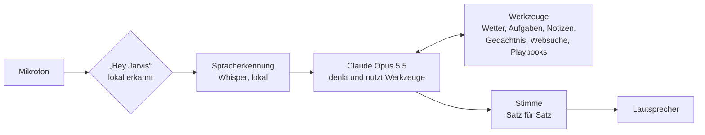

# J.A.R.V.I.S. – dein persönlicher Sprachassistent

Ein Jarvis wie aus *Iron Man*, gebaut mit Claude: Du sprichst mit ihm, er antwortet mit einer natürlichen
Stimme, erledigt Alltagsaufgaben und hilft dir beim Aufbau deines Business.

```text
Du:      Hey Jarvis, brauche ich morgen einen Schirm?
Jarvis:  Ja, morgen Nachmittag ist Regen angesagt, bei etwa 14 Grad. Ein Schirm wäre klug.
Du:      Erinnere mich um acht daran.
Jarvis:  Erledigt. Ich erinnere Sie morgen um acht Uhr an den Schirm.
```

## Was Jarvis heute schon kann

| Fähigkeit | Zum Beispiel |
|---|---|
| Gespräch auf Deutsch mit schöner Stimme | „Hey Jarvis, erklär mir kurz, was eine GmbH von einer UG unterscheidet.“ |
| Wetter | „Wie wird das Wetter am Wochenende in Hamburg?“ |
| Erinnerungen und Timer | „Erinnere mich in 20 Minuten an den Ofen.“ |
| Aufgabenliste | „Setz ‚Steuerberater anrufen‘ auf meine Liste.“ |
| Notizen | „Notiere meine Business-Idee: ein Kaffee-Abo für Büros.“ |
| Langzeitgedächtnis | „Merk dir, dass mein Steuerberater Herr Weber heißt.“ |
| Websuche für Aktuelles | „Was gibt es Neues zum Thema Gründerzuschuss?“ |
| Business-Berater mit 355 Experten-Playbooks | „Wie finde ich den richtigen Preis für mein Produkt?“ |
| Websites öffnen | „Öffne YouTube mit entspannter Musik.“ |

Jarvis lernt dich kennen: Beim ersten Gespräch fragt er nach deinem Namen und wie du angesprochen werden
möchtest (Sie oder Du, gern auch „Sir“ wie im Film) und merkt es sich dauerhaft.

## Ehrlich gesagt: was (noch) nicht geht

- **Kein Film-Jarvis, der allein deine Firma führt.** Jarvis ist ein sehr fähiger Assistent und Sparringspartner,
  Entscheidungen triffst du.
- **Läuft auf deinem Computer**, solange das Programm geöffnet ist. Handy-Zugang ist eine geplante Ausbaustufe.
- **Noch kein Zugriff auf E-Mail, Kalender oder Smart Home.** Das sind die nächsten Schritte (siehe Fahrplan).
- **Die Originalstimme aus dem Film darf nicht nachgebaut werden** (Stimmrechte des Schauspielers). Wir wählen
  oder entwerfen stattdessen eine ähnlich elegante, eigene Stimme.
- **Claude kostet ein wenig Geld** (Abrechnung nach Nutzung, siehe [Kosten](#kosten)).

## Schnellstart (etwa 15 Minuten)

**1. Python installieren** – Version 3.11 oder 3.12 von [python.org](https://www.python.org/downloads/).
Unter Windows beim Installieren „Add python.exe to PATH“ anhaken.

**2. Projekt herunterladen**

```bash
git clone https://github.com/bollotelli/claude-skills.git
cd claude-skills
git checkout claude/jarvis-ai-assistant-iah33k
cd jarvis
```

**3. Eigene Python-Umgebung anlegen und Pakete installieren**

```bash
# Mac / Linux
python3 -m venv .venv
source .venv/bin/activate

# Windows (PowerShell)
py -m venv .venv
.venv\Scripts\activate

# danach überall
pip install -r requirements.txt
pip install -r requirements-wake.txt   # optional: freihändig mit „Hey Jarvis“
```

Linux braucht zusätzlich die Audio-Bibliothek: `sudo apt install libportaudio2`.

**4. Claude-Schlüssel besorgen** – auf [console.anthropic.com](https://console.anthropic.com) ein Konto
anlegen, unter *Billing* etwas Guthaben aufladen (5–10 $ reichen für den Anfang) und unter *API Keys* einen
Schlüssel erstellen. Dann die Vorlage kopieren und den Schlüssel eintragen:

```bash
cp .env.example .env        # Windows: copy .env.example .env
```

In `.env`: `ANTHROPIC_API_KEY=sk-ant-...` – diese Datei bleibt auf deinem Rechner und wird nie hochgeladen.

**5. Prüfen, testen, loslegen**

```bash
python -m jarvis check --online   # ist alles eingerichtet?
python -m jarvis sag              # so klingt Jarvis
python -m jarvis --text           # erst einmal tippen
python -m jarvis                  # sprechen: Enter drücken, reden, Pause machen
python -m jarvis --wake           # freihändig: „Hey Jarvis, …“
```

Beim ersten Sprechen lädt Jarvis einmalig das Spracherkennungsmodell (rund 460 MB).
Auf dem Mac fragt das System nach Mikrofonzugriff für das Terminal – bitte erlauben.

## Jarvis' Stimme

| | Stimme | Kosten | Qualität | Internet |
|---|---|---|---|---|
| **edge** (Standard) | Microsoft-Neuralstimmen | kostenlos | sehr natürlich | ja |
| **ElevenLabs** | Studio-Stimmen, eigene Stimme entwerfbar | kostenloser Einstieg, dann Abo | am ausdrucksstärksten | ja |
| **Piper** | Open-Source-Stimme auf deinem Rechner | kostenlos | gut | nein |

**Stimmen ausprobieren (edge):**

```bash
python -m jarvis stimmen
python -m jarvis sag --stimme de-DE-ConradNeural "Guten Abend. Alle Systeme sind bereit."
```

Empfehlungen: `de-DE-FlorianMultilingualNeural` (Standard, warm und natürlich), `de-DE-ConradNeural`
(tief und seriös, sehr „Butler“), `de-DE-KillianNeural` (jung und klar), `en-GB-RyanNeural` (britisch wie im
Original, spricht Englisch). Die Lieblingsstimme trägst du in `.env` ein: `JARVIS_EDGE_VOICE=de-DE-ConradNeural`.
Feinschliff: `JARVIS_EDGE_RATE=-5%` spricht ruhiger, `JARVIS_EDGE_PITCH=-3Hz` tiefer.
Hinweis: edge nutzt die Vorlesefunktion von Microsoft Edge über eine inoffizielle Schnittstelle – ideal zum
Starten; für den dauerhaften Business-Einsatz ist ElevenLabs die solidere Wahl.

**ElevenLabs – die schönste Stimme:**

1. Konto auf [elevenlabs.io](https://elevenlabs.io) anlegen und unter *Profil → API Keys* einen Schlüssel erstellen.
2. In `.env`: `JARVIS_TTS=elevenlabs` und `ELEVENLABS_API_KEY=...`
3. Voreingestellt ist „George“ (warm, ruhig, britisch). Andere Stimmen findest du in der *Voice Library*;
   deren ID kommt in `JARVIS_ELEVENLABS_VOICE_ID`.
4. **Eigene Jarvis-Stimme:** Mit *Voice Design* beschreibst du die Stimme in Worten, z. B. „ruhiger, eleganter
   KI-Butler, tiefe warme Stimme, leicht britischer Akzent“, und erhältst eine einzigartige Stimme. Echte Personen
   (auch Schauspieler) bitte nur mit deren Einverständnis klonen.

**Piper – komplett offline:**

```bash
pip install piper-tts
python -m piper.download_voices --download-dir ~/.jarvis/stimmen de_DE-thorsten-high
```

Dann in `.env`: `JARVIS_TTS=piper` und `JARVIS_PIPER_MODEL=~/.jarvis/stimmen/de_DE-thorsten-high.onnx`.
„Thorsten“ ist eine freie deutsche Stimme, die Thorsten Müller für genau solche Projekte gespendet hat.

## So sprichst du mit Jarvis

- **Push-to-Talk** (`python -m jarvis`): Enter drücken, nach dem Signalton sprechen, kurz Pause machen –
  Jarvis antwortet.
- **Freihändig** (`python -m jarvis --wake`): „Hey Jarvis“ sagen (englisch: „Hey Dschar-wis“), Frage stellen.
  Nach der Antwort hört Jarvis ein paar Sekunden weiter zu, Rückfragen gehen also ohne erneutes „Hey Jarvis“.
- **Text** (`python -m jarvis --text`): tippen; Jarvis antwortet trotzdem mit Stimme (`--stumm` schaltet sie ab).
  Befehle: `/neu` neues Gespräch, `/kosten` Verbrauch, `/gedaechtnis` was Jarvis über dich weiß, `/ende`.
- **Unterbrechen:** Strg+C stoppt die aktuelle Antwort.

## Business-Modus

Jarvis lebt in einer Bibliothek mit **355 Experten-Playbooks** (die Ordner rund um `jarvis/`): Strategie,
Gründung, Preisgestaltung, Marketing, Vertrieb, Finanzen, Organisation, Recht und Compliance. Stellst du eine
Business-Frage, sucht Jarvis das passende Playbook, liest es und wendet das Framework auf deine Situation an.

- „Ich will einen Online-Shop für Kaffee starten. Wie gehe ich die ersten drei Monate an?“
- „Welches Preismodell passt zu einem Software-Abo für Handwerker?“
- „Hilf mir, eine Cashflow-Planung für das erste Jahr aufzusetzen.“
- „Schreib mir einen Entwurf für einen Elevator Pitch und speichere ihn als Notiz.“

Lange Ergebnisse (Pläne, Texte, Analysen) speichert Jarvis als Notiz und fasst sie mündlich kurz zusammen.

## Deine Daten

Alles Persönliche liegt als einfache Dateien in `~/.jarvis/` auf deinem Rechner und lässt sich mit jedem
Editor öffnen oder sichern:

| Datei | Inhalt |
|---|---|
| `gedaechtnis.json` | was Jarvis sich über dich gemerkt hat |
| `aufgaben.json` | deine Aufgabenliste |
| `erinnerungen.json` | Erinnerungen und Timer |
| `notizen/*.md` | Notizen als Markdown (passt z. B. zu Obsidian) |

**Was den Rechner verlässt:** Der Text deiner Frage geht an Anthropic (Claude), der Text von Jarvis' Antwort
an den Stimmendienst (Microsoft bei edge, ElevenLabs). Mit lokaler Spracherkennung und Piper bleibt das Audio
komplett auf deinem Rechner. Das Mikrofon nimmt erst nach Enter bzw. nach „Hey Jarvis“ auf; die
Wake-Word-Erkennung läuft lokal.

## Kosten

Grob geschätzt mit dem Standardmodell Claude Opus 5.5 (4 $ pro Million Eingabe-Tokens, 20 $ pro Million
Ausgabe-Tokens, Cache-Lesen 0,20 $; Stand Oktober 2026):

- **Ein gesprochener Wortwechsel kostet etwa 1 Cent**, der erste eines Gesprächs etwas mehr. Jarvis nutzt
  Prompt-Caching, damit die gleichbleibenden Anweisungen nur einmal voll berechnet werden.
- **Websuche:** etwa 1 Cent pro Suche.
- **Typischer Monat:** bei gelegentlicher Nutzung wenige Euro, bei intensiver täglicher Nutzung eher 10–20 $.
- **Stimme:** edge und Piper kostenlos, ElevenLabs je nach Abo. **Spracherkennung** lokal kostenlos.

`/kosten` zeigt im Textmodus den Verbrauch der laufenden Sitzung. Tipp: In der Claude Console unter
*Billing → Spend limits* ein Monatslimit setzen, dann gibt es keine Überraschungen.
Wer schnellere und günstigere Antworten möchte, kann `JARVIS_MODEL=claude-sonnet-5-5` setzen (2 $ / 10 $).

## Einstellungen

Alle Optionen stehen mit Erklärung in [`.env.example`](.env.example). Die wichtigsten:

| Einstellung | Standard | Bedeutung |
|---|---|---|
| `JARVIS_MODEL` | `claude-opus-5-5` | Claude-Modell |
| `JARVIS_EFFORT` | `low` | Denktiefe: `low` antwortet schnell, `medium`/`high` gründlicher |
| `JARVIS_LOCATION` | `Berlin` | Standardort für Wetter und lokale Suche |
| `JARVIS_TTS` | `edge` | Stimme: `edge`, `elevenlabs`, `piper`, `none` |
| `JARVIS_WHISPER_MODEL` | `small` | Spracherkennung: `medium` versteht besser, ist aber langsamer |
| `JARVIS_WAKE_THRESHOLD` | `0.5` | „Hey Jarvis“: niedriger reagiert leichter |
| `JARVIS_DATA_DIR` | `~/.jarvis` | Ordner für Gedächtnis, Aufgaben, Notizen |

## Wenn etwas hakt

| Problem | Lösung |
|---|---|
| „Kein API-Schlüssel gefunden“ | `ANTHROPIC_API_KEY` in `jarvis/.env` eintragen |
| „credit balance is too low“ | Guthaben in der Claude Console aufladen |
| Mac: Jarvis hört nichts | *Systemeinstellungen → Datenschutz & Sicherheit → Mikrofon* → Terminal erlauben |
| Linux: „PortAudio library not found“ | `sudo apt install libportaudio2` |
| Jarvis versteht schlecht | `JARVIS_WHISPER_MODEL=medium`, näher ans Mikrofon, ruhigere Umgebung |
| „Hey Jarvis“ reagiert nicht oder zu oft | `JARVIS_WAKE_THRESHOLD` zwischen `0.3` und `0.7` probieren |
| Mac: Zertifikatsfehler (SSL) | im Programme-Ordner „Python 3.x → Install Certificates.command“ ausführen |
| Pakete lassen sich nicht installieren | Python 3.11 oder 3.12 verwenden |

`python -m jarvis check` zeigt, was fehlt, und `python -m jarvis selbsttest` prüft die Programmlogik
offline, ohne API-Kosten.

## So funktioniert Jarvis



Claude streamt die Antwort; jeder fertige Satz geht sofort an die Stimme, während Claude weiterschreibt.
Deshalb beginnt Jarvis zu sprechen, bevor die Antwort vollständig ist.

| Datei | Aufgabe |
|---|---|
| `jarvis/brain.py` | Gespräch mit Claude: Streaming, Werkzeugaufrufe, Caching |
| `jarvis/persona.py` | Jarvis' Charakter und Regeln |
| `jarvis/tools/` | Fähigkeiten: Wetter, Aufgaben, Notizen, Gedächtnis, Erinnerungen, Playbooks |
| `jarvis/speech.py` | Sätze erkennen und nacheinander vorlesen |
| `jarvis/tts.py` / `jarvis/stt.py` | Stimme / Spracherkennung |
| `jarvis/audio.py` | Mikrofon, Lautsprecher, „Hey Jarvis“ |
| `jarvis/app.py` | Hauptschleife der drei Modi |

Eine neue Fähigkeit hinzufügen heißt: eine Methode und einen `Tool`-Eintrag in `jarvis/tools/__init__.py`.

## Fahrplan: was wir als Nächstes bauen können

1. **Kalender und E-Mail** (Google oder Microsoft): „Was steht morgen an?“, „Fasse meine ungelesenen Mails zusammen.“
2. **Jarvis aufs Handy** über einen Telegram-Bot oder einen iPhone-Kurzbefehl.
3. **Smart Home** über Home Assistant: „Licht im Büro an.“
4. **Unterbrechen beim Sprechen:** einfach dazwischenreden.
5. **Morgenbriefing:** Wetter, Termine, Aufgaben und Nachrichten in einer Minute.
6. **Business-Werkzeuge:** Kundenliste, Angebote und Rechnungen, Kennzahlen deines Business.
7. **Iron-Man-Oberfläche** im Browser mit animiertem Jarvis-Kreis.
