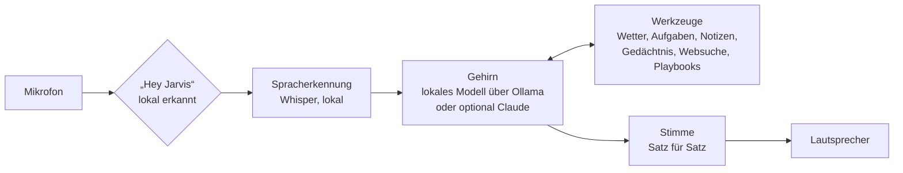

# J.A.R.V.I.S. – dein persönlicher Sprachassistent

Ein Jarvis wie aus *Iron Man*: Du sprichst mit ihm, er antwortet mit einer natürlichen Stimme, erledigt
Alltagsaufgaben und hilft dir beim Aufbau deines Business. **In der Grundeinstellung ist alles komplett
kostenlos**: Das „Gehirn“ ist ein offenes KI-Modell, das auf deinem eigenen Rechner läuft – ohne Abo, ohne
API-Schlüssel, ohne Kosten pro Frage.

```text
Du:      Hey Jarvis, brauche ich morgen einen Schirm?
Jarvis:  Ja, morgen Nachmittag ist Regen angesagt, bei etwa 14 Grad. Ein Schirm wäre klug.
Du:      Erinnere mich um acht daran.
Jarvis:  Erledigt. Ich erinnere Sie morgen um acht Uhr an den Schirm.
```

## Was Jarvis heute schon kann

| Fähigkeit | Zum Beispiel |
|---|---|
| Gespräch auf Deutsch mit schöner Stimme | „Hey Jarvis, erklär mir kurz, was eine GmbH von einer UG unterscheidet.“ |
| Wetter | „Wie wird das Wetter am Wochenende in Hamburg?“ |
| Erinnerungen und Timer | „Erinnere mich in 20 Minuten an den Ofen.“ |
| Aufgabenliste | „Setz ‚Steuerberater anrufen‘ auf meine Liste.“ |
| Notizen | „Notiere meine Business-Idee: ein Kaffee-Abo für Büros.“ |
| Langzeitgedächtnis | „Merk dir, dass mein Steuerberater Herr Weber heißt.“ |
| Websuche und Nachrichten | „Was gibt es Neues zum Thema Gründerzuschuss?“ |
| Business-Berater mit 355 Experten-Playbooks | „Wie finde ich den richtigen Preis für mein Produkt?“ |
| Websites öffnen | „Öffne YouTube mit entspannter Musik.“ |

Jarvis lernt dich kennen: Beim ersten Gespräch fragt er nach deinem Namen und wie du angesprochen werden
möchtest (Sie oder Du, gern auch „Sir“ wie im Film) und merkt es sich dauerhaft.

## Was kostet das? Nichts.

| Baustein | Lösung | Kosten |
|---|---|---|
| Gehirn | offenes KI-Modell über [Ollama](https://ollama.com), läuft auf deinem Rechner | kostenlos |
| Stimme | Microsoft-Neuralstimmen (edge) oder Piper (offline) | kostenlos |
| Spracherkennung | Whisper, läuft auf deinem Rechner | kostenlos |
| „Hey Jarvis“ | openWakeWord, läuft auf deinem Rechner | kostenlos |
| Websuche | DuckDuckGo und andere Suchmaschinen über `ddgs` | kostenlos |
| Wetter | Open-Meteo | kostenlos |

Du zahlst nur den Strom deines Rechners. `python -m jarvis check` zeigt in der Zeile „Kosten“ an, ob deine
Einstellungen wirklich komplett kostenlos sind.

Wer später mehr will, kann **freiwillig** aufrüsten: Claude als Gehirn (deutlich klüger, etwa 1 Cent pro
Wortwechsel) oder eine ElevenLabs-Stimme (Abo). Beides ist ausgeschaltet, solange du es nicht einträgst.

## Ehrlich gesagt: was du wissen solltest

- **Das kostenlose Gehirn ist gut, aber nicht so klug wie Claude.** Für Alltag, Notizen, Erinnerungen und
  einfache Business-Fragen reicht es; bei komplexen Analysen merkt man den Unterschied. Ab und zu ruft es ein
  Werkzeug falsch auf – dann einfach anders formulieren.
- **Dein Rechner rechnet selbst.** Mit 16 GB Arbeitsspeicher läuft es flüssig, mit 8 GB nimmst du das kleinere
  Modell (siehe unten). Die erste Antwort nach dem Start dauert ein paar Sekunden länger, weil das Modell lädt.
- **Läuft auf deinem Computer**, solange das Programm geöffnet ist. Handy-Zugang ist eine geplante Ausbaustufe.
- **Noch kein Zugriff auf E-Mail, Kalender oder Smart Home** – das sind die nächsten Schritte (siehe Fahrplan).
- **Die Originalstimme aus dem Film darf nicht nachgebaut werden** (Stimmrechte des Schauspielers). Wir wählen
  stattdessen eine ähnlich elegante Stimme.

## Welches Modell passt zu deinem Rechner?

| Arbeitsspeicher (RAM) | Modell | Einstellung in `.env` |
|---|---|---|
| 8 GB | `qwen3:4b` (ca. 2,5 GB Download) | `JARVIS_OLLAMA_MODEL=qwen3:4b` |
| 16 GB (Standard) | `qwen3:8b` (ca. 5 GB Download) | – |
| 32 GB oder starke Grafikkarte | `qwen3:14b` (ca. 9 GB Download) | `JARVIS_OLLAMA_MODEL=qwen3:14b` |

Macs mit Apple-Chip (M1 bis M4) sind dafür besonders gut geeignet. Auf älteren Windows-Laptops ohne
Grafikkarte lieber `qwen3:4b` nehmen.

## Schnellstart (etwa 20 Minuten, davon viel Download)

**1. Python installieren** – Version 3.11 oder 3.12 von [python.org](https://www.python.org/downloads/).
Unter Windows beim Installieren „Add python.exe to PATH“ anhaken.

**2. Ollama installieren und das Modell laden** – [ollama.com/download](https://ollama.com/download)
herunterladen und starten. Dann im Terminal einmalig:

```bash
ollama pull qwen3:8b
```

**3. Projekt holen** – entweder das Zip-Paket entpacken (den Ordner `jarvis` am besten in deinen
`claude-skills`-Ordner legen, damit Jarvis die Business-Playbooks findet) oder per git:

```bash
git clone https://github.com/bollotelli/claude-skills.git
cd claude-skills
git checkout claude/jarvis-ai-assistant-iah33k
```

**4. Eigene Python-Umgebung anlegen und Pakete installieren** (alle kostenlos)

```bash
cd jarvis

# Mac / Linux
python3 -m venv .venv
source .venv/bin/activate

# Windows (PowerShell)
py -m venv .venv
.venv\Scripts\activate

# danach überall
pip install -r requirements.txt
pip install -r requirements-wake.txt   # optional: freihändig mit „Hey Jarvis“
```

Linux braucht zusätzlich die Audio-Bibliothek: `sudo apt install libportaudio2`.

**5. Prüfen, testen, loslegen** – ein API-Schlüssel ist nicht nötig.

```bash
python -m jarvis check            # ist alles eingerichtet und kostenlos?
python -m jarvis sag              # so klingt Jarvis
python -m jarvis --text           # erst einmal tippen
python -m jarvis                  # sprechen: Enter drücken, reden, Pause machen
python -m jarvis --wake           # freihändig: „Hey Jarvis, …“
```

Beim ersten Sprechen lädt Jarvis einmalig das Spracherkennungsmodell (rund 460 MB).
Auf dem Mac fragt das System nach Mikrofonzugriff für das Terminal – bitte erlauben.
Eigene Einstellungen (Ort, Stimme, Modell) trägst du in eine Datei `.env` ein: `cp .env.example .env`
(Windows: `copy .env.example .env`) und die gewünschten Zeilen anpassen.

## Jarvis' Stimme

| | Stimme | Kosten | Qualität | Internet |
|---|---|---|---|---|
| **edge** (Standard) | Microsoft-Neuralstimmen | kostenlos | sehr natürlich | ja |
| **Piper** | Open-Source-Stimme auf deinem Rechner | kostenlos | gut | nein |
| **ElevenLabs** (optional) | Studio-Stimmen, eigene Stimme entwerfbar | Abo | am ausdrucksstärksten | ja |

**Stimmen ausprobieren (edge):**

```bash
python -m jarvis stimmen
python -m jarvis sag --stimme de-DE-ConradNeural "Guten Abend. Alle Systeme sind bereit."
```

Empfehlungen: `de-DE-FlorianMultilingualNeural` (Standard, warm und natürlich), `de-DE-ConradNeural`
(tief und seriös, sehr „Butler“), `de-DE-KillianNeural` (jung und klar), `en-GB-RyanNeural` (britisch wie im
Original, spricht Englisch). Die Lieblingsstimme trägst du in `.env` ein: `JARVIS_EDGE_VOICE=de-DE-ConradNeural`.
Feinschliff: `JARVIS_EDGE_RATE=-5%` spricht ruhiger, `JARVIS_EDGE_PITCH=-3Hz` tiefer.
Hinweis: edge nutzt die kostenlose Vorlesefunktion von Microsoft Edge über eine inoffizielle Schnittstelle.
Sollte sie einmal nicht gehen, ist Piper die kostenlose Alternative.

**Piper – kostenlos und komplett offline:**

```bash
pip install piper-tts
python -m piper.download_voices --download-dir ~/.jarvis/stimmen de_DE-thorsten-high
```

Dann in `.env`: `JARVIS_TTS=piper` und `JARVIS_PIPER_MODEL=~/.jarvis/stimmen/de_DE-thorsten-high.onnx`.
„Thorsten“ ist eine freie deutsche Stimme, die Thorsten Müller für genau solche Projekte gespendet hat.

**ElevenLabs (optional, kostenpflichtig):** Konto auf [elevenlabs.io](https://elevenlabs.io), Schlüssel unter
*Profil → API Keys*, dann `JARVIS_TTS=elevenlabs` und `ELEVENLABS_API_KEY=...` in `.env`. Mit *Voice Design*
kannst du dort eine eigene Jarvis-Stimme per Beschreibung entwerfen. Echte Personen (auch Schauspieler) bitte
nur mit deren Einverständnis klonen.

## So sprichst du mit Jarvis

- **Push-to-Talk** (`python -m jarvis`): Enter drücken, nach dem Signalton sprechen, kurz Pause machen –
  Jarvis antwortet.
- **Freihändig** (`python -m jarvis --wake`): „Hey Jarvis“ sagen (englisch: „Hey Dschar-wis“), Frage stellen.
  Nach der Antwort hört Jarvis ein paar Sekunden weiter zu, Rückfragen gehen also ohne erneutes „Hey Jarvis“.
- **Text** (`python -m jarvis --text`): tippen; Jarvis antwortet trotzdem mit Stimme (`--stumm` schaltet sie ab).
  Befehle: `/neu` neues Gespräch, `/kosten` Verbrauch, `/gedaechtnis` was Jarvis über dich weiß, `/ende`.
- **Unterbrechen:** Strg+C stoppt die aktuelle Antwort.

## Business-Modus

Jarvis lebt in einer Bibliothek mit **355 Experten-Playbooks** (die Ordner rund um `jarvis/`): Strategie,
Gründung, Preisgestaltung, Marketing, Vertrieb, Finanzen, Organisation, Recht und Compliance. Stellst du eine
Business-Frage, sucht Jarvis das passende Playbook, liest es und wendet das Framework auf deine Situation an.

- „Ich will einen Online-Shop für Kaffee starten. Wie gehe ich die ersten drei Monate an?“
- „Welches Preismodell passt zu einem Software-Abo für Handwerker?“
- „Hilf mir, eine Cashflow-Planung für das erste Jahr aufzusetzen.“
- „Schreib mir einen Entwurf für einen Elevator Pitch und speichere ihn als Notiz.“

Lange Ergebnisse speichert Jarvis als Notiz und fasst sie mündlich kurz zusammen. Das lokale Modell liest
lange Playbooks nur in Auszügen (sein Kurzzeitgedächtnis ist kleiner); Claude liest sie vollständig.

## Deine Daten

Alles Persönliche liegt als einfache Dateien in `~/.jarvis/` auf deinem Rechner und lässt sich mit jedem
Editor öffnen oder sichern:

| Datei | Inhalt |
|---|---|
| `gedaechtnis.json` | was Jarvis sich über dich gemerkt hat |
| `aufgaben.json` | deine Aufgabenliste |
| `erinnerungen.json` | Erinnerungen und Timer |
| `notizen/*.md` | Notizen als Markdown (passt z. B. zu Obsidian) |

**Was den Rechner verlässt:** Mit dem kostenlosen lokalen Gehirn bleiben deine Gespräche auf deinem Rechner.
Ins Internet gehen nur Suchanfragen (an die Suchmaschinen), der Ort für das Wetter (an Open-Meteo) und – mit
der edge-Stimme – der Text von Jarvis' Antworten (an Microsoft). Mit Piper bleibt auch die Stimme lokal.
Das Mikrofon nimmt erst nach Enter bzw. nach „Hey Jarvis“ auf; die Wake-Word-Erkennung läuft lokal.

## Einstellungen

Alle Optionen stehen mit Erklärung in [`.env.example`](.env.example). Die wichtigsten:

| Einstellung | Standard | Bedeutung |
|---|---|---|
| `JARVIS_BRAIN` | `local` | `local` = kostenloses Modell über Ollama, `claude` = Claude (kostenpflichtig) |
| `JARVIS_OLLAMA_MODEL` | `qwen3:8b` | lokales Modell, siehe Tabelle oben |
| `JARVIS_OLLAMA_CTX` | `12288` | Gesprächsgedächtnis in Tokens; mehr braucht mehr RAM |
| `JARVIS_LOCATION` | `Berlin` | Standardort für Wetter und lokale Suche |
| `JARVIS_TTS` | `edge` | Stimme: `edge`, `piper`, `elevenlabs`, `none` |
| `JARVIS_WHISPER_MODEL` | `small` | Spracherkennung: `medium` versteht besser, ist aber langsamer |
| `JARVIS_WAKE_THRESHOLD` | `0.5` | „Hey Jarvis“: niedriger reagiert leichter |
| `JARVIS_DATA_DIR` | `~/.jarvis` | Ordner für Gedächtnis, Aufgaben, Notizen |

**Optionales Upgrade auf Claude:** Auf [console.anthropic.com](https://console.anthropic.com) Guthaben aufladen
und einen API-Schlüssel erstellen, dann in `.env`: `JARVIS_BRAIN=claude` und `ANTHROPIC_API_KEY=sk-ant-...`.
Standardmodell ist Claude Opus 5.5 (etwa 1 Cent pro Wortwechsel, Websuche etwa 1 Cent pro Suche; mit `/kosten`
siehst du den Verbrauch). Falls Claude eine Anfrage ablehnt, springt automatisch ein Ersatzmodell ein.

## Wenn etwas hakt

| Problem | Lösung |
|---|---|
| „Ollama läuft nicht“ | Ollama-App starten (Mac/Windows) oder `ollama serve` (Linux) |
| „Modell ist nicht installiert“ | `ollama pull qwen3:8b` (bzw. das Modell aus deiner `.env`) |
| Antworten kommen sehr langsam | kleineres Modell: `JARVIS_OLLAMA_MODEL=qwen3:4b` |
| Jarvis vergisst den Anfang langer Gespräche | `JARVIS_OLLAMA_CTX=16384` (braucht mehr RAM) oder `/neu` |
| Mac: Jarvis hört nichts | *Systemeinstellungen → Datenschutz & Sicherheit → Mikrofon* → Terminal erlauben |
| Linux: „PortAudio library not found“ | `sudo apt install libportaudio2` |
| Jarvis versteht schlecht | `JARVIS_WHISPER_MODEL=medium`, näher ans Mikrofon, ruhigere Umgebung |
| „Hey Jarvis“ reagiert nicht oder zu oft | `JARVIS_WAKE_THRESHOLD` zwischen `0.3` und `0.7` probieren |
| „Die Suche ist gerade überlastet“ | kurz warten; die kostenlosen Suchmaschinen begrenzen schnelle Anfragen |
| Keine Stimme | Internet prüfen oder auf Piper (offline) wechseln |
| Pakete lassen sich nicht installieren | Python 3.11 oder 3.12 verwenden |

`python -m jarvis check` zeigt, was fehlt, und `python -m jarvis selbsttest` prüft die Programmlogik offline.

## So funktioniert Jarvis



Das Gehirn streamt die Antwort; jeder fertige Satz geht sofort an die Stimme, während der Rest noch entsteht.
Deshalb beginnt Jarvis zu sprechen, bevor die Antwort vollständig ist.

| Datei | Aufgabe |
|---|---|
| `jarvis/local_brain.py` | kostenloses Gehirn: lokales Modell über Ollama |
| `jarvis/brain.py` | optionales Gehirn: Claude (Streaming, Caching, Ersatzmodell) |
| `jarvis/persona.py` | Jarvis' Charakter und Regeln |
| `jarvis/tools/` | Fähigkeiten: Wetter, Aufgaben, Notizen, Gedächtnis, Erinnerungen, Websuche, Playbooks |
| `jarvis/speech.py` | Sätze erkennen und nacheinander vorlesen |
| `jarvis/tts.py` / `jarvis/stt.py` | Stimme / Spracherkennung |
| `jarvis/audio.py` | Mikrofon, Lautsprecher, „Hey Jarvis“ |
| `jarvis/app.py` | Hauptschleife der drei Modi |

Eine neue Fähigkeit hinzufügen heißt: eine Methode und einen `Tool`-Eintrag in `jarvis/tools/__init__.py`.

## Fahrplan: was wir als Nächstes bauen können

1. **Kalender und E-Mail** (Google oder Microsoft): „Was steht morgen an?“, „Fasse meine ungelesenen Mails zusammen.“
2. **Jarvis aufs Handy** über einen Telegram-Bot oder einen iPhone-Kurzbefehl.
3. **Smart Home** über Home Assistant: „Licht im Büro an.“
4. **Unterbrechen beim Sprechen:** einfach dazwischenreden.
5. **Morgenbriefing:** Wetter, Termine, Aufgaben und Nachrichten in einer Minute.
6. **Business-Werkzeuge:** Kundenliste, Angebote und Rechnungen, Kennzahlen deines Business.
7. **Iron-Man-Oberfläche** im Browser mit animiertem Jarvis-Kreis.
